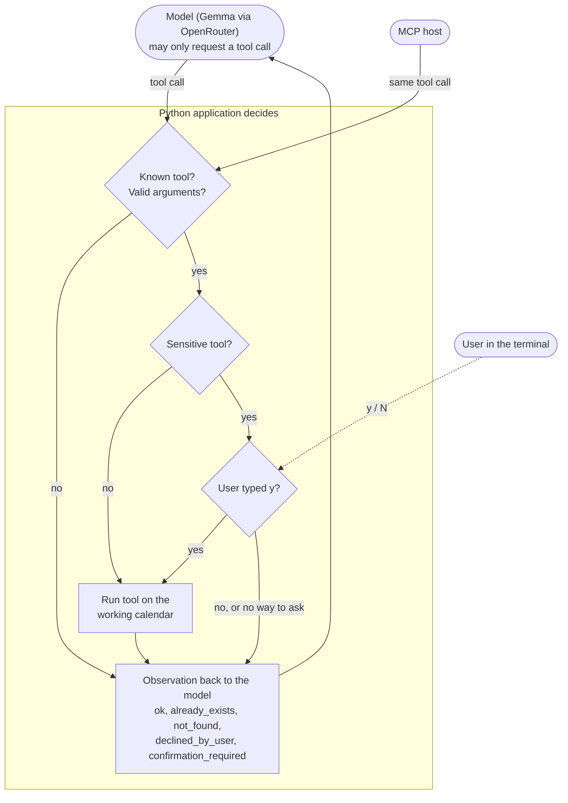

# Calendar Assistant Agent

Student project for the **Designing LLM/VLM Agents** course. An agent that
answers questions about a personal calendar — availability, conflicts, and past
events — by choosing which calendar tools to call and reacting to what they
return.

## Setup

```bash
git clone <repository-url>
cd my-calendar-assistant
uv sync --locked
cp .env.example .env
uv run pytest
```

Put an OpenRouter API key in `.env`. The file is ignored by Git; the key must
never appear in code, traces, issues, or reports. To check the connection:

```bash
uv run python -c 'from agent_project.llm import OpenRouterClient; print(OpenRouterClient(model="google/gemma-4-26b-a4b-it", temperature=0).complete([{"role": "user", "content": "Reply with exactly COURSE_READY"}])["text"])'
```

## Usage

```bash
uv run calendar-agent "Can I go to the Python meetup on Friday 23.10, 18:00-20:00?" --today 2026-10-16
```

The agent prints its answer, the number of steps, the cost, and the trace file.
Deletions ask `Delete '...'? [y/N]` first. When the agent needs more details it
asks a question; answer with `--thread <id>`. Every run also writes SVG and
Mermaid diagrams of its path to `traces/diagrams/`. The agent works on
`workspace/calendar.ics`, a copy of `data/calendar.ics`; settings live in
`calendar-agent.toml`.

More:

- [CLI usage](docs/usage.md) — options, config, clarifying questions, exit
  codes, traces, run diagrams;
- [Integrations](docs/integrations.md) — LangGraph Studio, chat UI (`ui/`), MCP
  server, Google Calendar and Google Tasks;
- [Evaluation](docs/evaluation.md) — M3 checkpoint, citation checks, design notes.

## Project Brief

- **Project title:** Calendar Assistant Agent.
- **Intended user:** a student or anyone with a busy personal calendar who
  wants quick answers without scrolling through weeks of events.
- **Problem and primary task:** answer questions such as "Am I free on Friday
  at 18:00, and if not, can I move what conflicts?" or "When was I last at the
  dentist and how long did it take?". Later the agent will also read posters,
  timetables and email screenshots and propose new events.
- **Why an agent is appropriate:** the next step depends on what the calendar
  returns. A conflict leads to checking alternatives; an empty search leads to
  a different keyword (entries are in Polish, questions may be in English); a
  missing entry leads to an explicit "not found" instead of a guess. A fixed
  pipeline cannot make these choices.
- **Data:** a local `.ics` calendar (`data/calendar.ics`, 22 fictional
  events) and six fictional documents in `data/docs/` (19 indexed fragments).
  Google Calendar is an optional backend; evaluation always uses the fixed
  fictional file.
- **Tools:** read-only `search_events` and `free_busy`, reversible
  `create_event`, and sensitive `delete_event` that needs the user's
  confirmation; all four are also exposed through a local MCP server.
- **Planned visual input:** a photo of a poster, a class timetable, or an email
  screenshot with a date — the agent reads it with a tool and checks it against
  the calendar.
- **Success criteria:** answers cite only events returned by tools; conflicts
  are detected; questions with no matching data end with outcome `not_found`;
  every run stays within 12 model steps and USD 0.10, and is fully traced.
- **Non-goals and safety boundaries:** the agent works on a local copy, never
  on the source data; nothing is deleted without an explicit yes from the user;
  no invitations or emails;
  event titles and descriptions are treated as data, never as instructions;
  real calendar data never goes into `evidence/`.

A good result for "Can I go to the meetup on 23.10 at 18:00?" is: "No — your
Operating Systems lab is 17:30–19:00. The lab can be made up with group 1 on
Wednesday 21.10, 12:00–13:30, and you are free then."

## How the Agent Works

```text
goal -> model chooses a tool -> code checks the request -> code runs the tool
     -> result goes back to the model -> model decides again or calls finish
```

**The model only proposes.** Every tool request is checked in
`execute_tool_call` (`src/agent_project/tools.py`): the tool must exist, the
arguments must pass the Pydantic model, and a sensitive tool must get a real
confirmation from the user. A rejected request or a domain outcome
(`already_exists`, `declined_by_user`, ...) goes back to the model as an
observation, so it can correct itself.

| Tool | Type | Checked by the application |
|---|---|---|
| `search_events` | read-only | keywords, date range, result limit |
| `free_busy` | read-only | window order, at most 14 days |
| `create_event` | reversible write | title and times, at most 24 h; `already_exists` for the same title at the same start; overlaps returned as `conflicts` |
| `delete_event` | sensitive | event exists (`not_found`); the user answers `y` in the terminal, otherwise `declined_by_user`; without a way to ask (MCP) `confirmation_required` |



**The run ends** (`src/agent_project/agent.py`) when the model calls `finish`
with outcome `answered` (status `success`), `not_found`, or `clarify`. A plain
text reply is sent back with a request to call `finish`; it never silently
becomes `success`. Technical exits: the model call fails or three tool requests
in a row are rejected (`error`), 12 steps (`step_limit`), or more than USD 0.10
(`cost_limit`).

## Model and Limits

- All live runs use `google/gemma-4-26b-a4b-it` via OpenRouter.
- A typical run costs well under USD 0.01.
- Tests use the mock client and make no API calls.

## Commands

```bash
uv run pytest
uv run ruff check .
```
