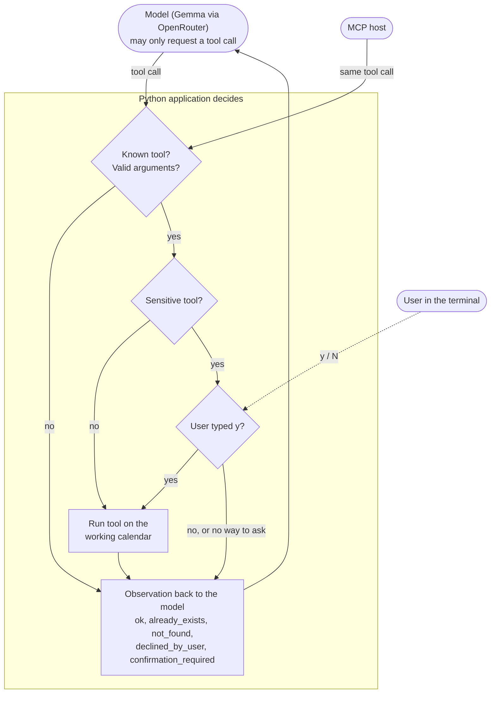

# Calendar Assistant Agent

Student project for the **Designing LLM/VLM Agents** course. An agent that
answers questions about a personal calendar — availability, conflicts, and past
events — by choosing which calendar tools to call and reacting to what they
return.

## Setup

```bash
git clone <repository-url>
cd my-calendar-assistant
uv sync --locked
cp .env.example .env
uv run pytest
```

Put an OpenRouter API key in `.env`. The file is ignored by Git; the key must
never appear in code, traces, issues, or reports. To check the connection:

```bash
uv run python -c 'from agent_project.llm import OpenRouterClient; print(OpenRouterClient(model="google/gemma-4-26b-a4b-it", temperature=0).complete([{"role": "user", "content": "Reply with exactly COURSE_READY"}])["text"])'
```

## Usage

```bash
uv run calendar-agent "Can I go to the Python meetup on Friday 23.10, 18:00-20:00?" --today 2026-10-16
```

```bash
uv run calendar-agent "Add the gym on Monday 19.10, 18:00-19:30." --today 2026-10-16
uv run calendar-agent "Delete my maths tutoring on 22.10." --today 2026-10-16
```

The agent prints its answer and a status line with the number of steps, the
cost, and the trace file. Before any deletion the terminal asks
`Delete '...'? [y/N]`; only an explicit `y` deletes. Options:

- `--calendar PATH|google` — working calendar the agent reads and changes
  (default `CALENDAR_BACKEND` from `.env`, else `workspace/calendar.ics`, copied
  from `data/calendar.ics` on first use); `google` uses Google Calendar and
  Google Tasks (see below);
- `--today YYYY-MM-DD` — fixed "today" for reproducible runs;
- `--trace PATH` — trace file (default `traces/run-<timestamp>.jsonl`);
- `--thread ID` — answer the agent's clarifying question in that conversation.

The model, its temperature, the limits and the conversation database are set in
`calendar-agent.toml`, the only source of these values: edit it to experiment.
A missing file, a missing or unknown key, or a wrong type stops the CLI with
exit code `2`. `max_steps` and `max_cost_usd` apply to each run (turn);
`max_clarifications` applies to the whole conversation.

When the agent needs more details, it asks, saves the conversation to SQLite
(`workspace/conversations.sqlite`) and exits. Answer in a new run with the
printed thread id; the agent continues with the same goal, messages and tool
results:

```bash
uv run calendar-agent "Umów spotkanie z Tomkiem" --today 2026-10-16
# Kiedy i na jak długo?
# [answer with: calendar-agent "..." --thread 3f9c...]
uv run calendar-agent "12 grudnia o 13, godzina" --thread 3f9c... --today 2026-10-16
```

Pass the same `--calendar` as in the first run. The exit code is `0` when the
run ends with status `success` or waits for an answer (`clarify`), `1` for
other statuses, and `2` for a bad config or a thread that cannot take an
answer.
`data/calendar.ics` never changes; delete `workspace/calendar.ics` to start
over from the original.

### Visual run debugging

At the end of every agent run, diagrams are generated automatically in a
`diagrams/` folder beside the JSONL trace (normally `traces/diagrams/`):
an `.svg` file that opens in a browser, and an editable Mermaid `.mmd` file.
They share the trace's filename stem. This also works when calling `run_agent`
directly from Python, including runs ending in abstention, errors, or limits.
No separate command is needed.
Both include a legend, model requests, tool results, human confirmations,
graph node visits, and the final outcome. Repeated searches stay separate,
so their order is visible. This shows the executed path, rather than every
possible branch of the workflow. No additional dependencies or API calls are used.

For older logs only, you can also export without running the agent:

```powershell
.venv\Scripts\python.exe -m agent_project.trace_graph evidence/m3-abstention.jsonl
```

Use `--output traces/presentation` to choose the output stem. Open the SVG
directly in a browser, or edit the MMD in an editor with Mermaid support.
Older traces show only the events they actually recorded; new traces also
include `graph_node` events with the next node, source count, and status.
Partial traces are marked incomplete. One input file must contain one run.
Diagram text is abbreviated; JSONL retains full details. Diagrams contain
user questions and tool data, so review them before sharing.

### LangGraph Studio

Studio shows the agent graph in the browser and highlights each node as it
runs. You can open the state after any node, and answer the agent's questions
there.

1. Create a free LangSmith account. Put its API key in `.env` as
   `LANGSMITH_API_KEY`. Keep `LANGSMITH_TRACING=false`, so runs are not sent
   to LangSmith.
2. Run `uv run langgraph dev`. The command opens Studio for the server on
   `http://127.0.0.1:2024`. With `LANGSMITH_TRACING=true`, run
   `uv run langgraph dev --allow-blocking` instead: the LangSmith tracer reads
   the working directory on the server's event loop, and without the flag the
   dev server blocks that call and runs are not traced.
3. In the graph view, choose `calendar_agent` and enter a `goal`.

The page loads from LangChain's site, but the agent and its data stay on your
computer. Studio uses `calendar-agent.toml` and the same working calendar as
the CLI. It keeps its own conversations, separate from the CLI's
`--thread` ones.

When the graph stops, resume it with one of these values:

| Pause `kind` | Why it stopped | Resume with |
|---|---|---|
| `clarify` | the model asks you a question | your answer as text |
| `confirm` | `delete_event` needs your approval | `true` deletes; any other value declines |

To set today's date, open the assistant at the bottom of the input panel and
fill `Today` (for example `2026-10-16`); empty means the real date. Each Studio run writes `traces/server-<time>.jsonl`.
Studio runs have no `run_end` event and no diagram.

### Chat UI

A lightweight ChatGPT-style web interface lives in `ui/` and talks to the same
LangGraph server. Start the server and the UI in two terminals:

```bash
uv run langgraph dev --no-browser
```

```bash
cd ui && npm install && npm run dev
```

Open `http://localhost:5173` in your browser. LangGraph Studio (using the link
printed by `langgraph dev`) remains available as the debug view of the same
running server.

### MCP server

The same tools are available to any MCP host (Claude Code, Claude Desktop,
MCP Inspector) through a local stdio server:

```bash
uv run calendar-mcp
uv run mcp dev src/agent_project/mcp_server.py
```

The second command opens the MCP Inspector (needs `npx`). The server uses the
same working calendar as the CLI. It has no way to ask the user, so
`delete_event` and `delete_task` over MCP always return `confirmation_required`
and delete nothing. It cannot see what the user said either, so `create_event`
over MCP has no calendar parameter: events always go to the default calendar.

### Google Calendar and Google Tasks

1. In Google Cloud Console create a project, enable the **Google Calendar
   API** and the **Google Tasks API**, and add yourself as a test user on the
   OAuth consent screen.
2. Create an OAuth client of type **Desktop app** and save its JSON as
   `workspace/credentials.json` (ignored by Git).
3. Run with `--calendar google`, or set `CALENDAR_BACKEND=google` in `.env` for
   the CLI, Studio and the MCP server. The first run opens a browser to sign in
   and caches the token in `workspace/token.json`.

The agent reads every calendar shown in the Google Calendar UI, from 180 days
before today to 180 days after, and every Google Tasks list. Questions about
days outside that window are refused (`outside_loaded_range`), not answered as
free. All calendars count for free/busy, except all-day events and events marked
"available". A new event goes to the calendar you named; without one it goes to
your primary calendar, or to `GOOGLE_DEFAULT_CALENDAR` (a calendar name) from
`.env`. A calendar name you never said is rejected in code. Writes send no
e-mail invitations; `reminder_minutes` sets popup reminders.

Anything with a time of day, a deadline hour ("do 12") or reminders before it
becomes an event; things to check off with only a day become tasks, which
Google Calendar shows on their due day. A task goes to the list you named, or to
the default list; `move_task` moves it to another list. In the local file,
tasks are `VTODO` entries in the same `.ics`, in one list.

## Project Brief

- **Project title:** Calendar Assistant Agent.
- **Intended user:** a student or anyone with a busy personal calendar who
  wants quick answers without scrolling through weeks of events.
- **Problem and primary task:** answer questions such as "Am I free on Friday
  at 18:00, and if not, can I move what conflicts?" or "When was I last at the
  dentist and how long did it take?". Later the agent will also read posters,
  timetables and email screenshots and propose new events.
- **Why an agent is appropriate:** the next step depends on what the calendar
  returns. A conflict leads to checking alternatives; an empty search leads to
  a different keyword (entries are in Polish, questions may be in English); a
  missing entry leads to an explicit "not found" instead of a guess. A fixed
  pipeline cannot make these choices.
- **Data:** a local `.ics` calendar (`data/calendar.ics`, 22 fictional
  events) and six fictional documents in `data/docs/` (19 indexed fragments).
  A real Google
  Calendar is a later backend; evaluation always uses the fixed fictional file.
- **Tools:** read-only `search_events` and `free_busy`, reversible
  `create_event`, and sensitive `delete_event` that needs the user's
  confirmation; all four are also exposed through a local MCP server.
- **Planned visual input:** a photo of a poster, a class timetable, or an email
  screenshot with a date — the agent reads it with a tool and checks it against
  the calendar.
- **Success criteria:** answers cite only events returned by tools; conflicts
  are detected; questions with no matching data end with outcome `not_found`;
  every run stays within 12 model steps and USD 0.10, and is fully traced.
- **Non-goals and safety boundaries:** the agent works on a local copy, never
  on the source data; nothing is deleted without an explicit yes from the user;
  no invitations or emails;
  event titles and descriptions are treated as data, never as instructions;
  real calendar data never goes into `evidence/`.

A good result for "Can I go to the meetup on 23.10 at 18:00?" is: "No — your
Operating Systems lab is 17:30–19:00. The lab can be made up with group 1 on
Wednesday 21.10, 12:00–13:30, and you are free then."

## How the Agent Works

```text
goal -> model chooses a tool -> code checks the request -> code runs the tool
     -> result goes back to the model -> model decides again or calls finish
```

- **The model only proposes.** Every tool request is checked in
  `execute_tool_call` (`src/agent_project/tools.py`): the tool must exist, the
  arguments must be a JSON object that passes the Pydantic model (date ranges,
  result limits), and a sensitive tool must get a real confirmation from the
  user. A rejected request is returned to the model as an error observation
  (`unknown_tool`, `invalid_json`, `invalid_arguments`, `tool_failed`) so it
  can correct itself.

| Tool | Type | Checked by the application |
|---|---|---|
| `search_events` | read-only | keywords, date range, result limit |
| `free_busy` | read-only | window order, at most 14 days |
| `create_event` | reversible write | title and times, at most 24 h; `already_exists` for the same title at the same start; overlaps returned as `conflicts` |
| `delete_event` | sensitive | event exists (`not_found`); the user answers `y` in the terminal, otherwise `declined_by_user`; without a way to ask (MCP) `confirmation_required` |

The confirmation is an `interrupt()` in the graph. Before a batch of tool calls
runs, the graph asks about every sensitive call in it, one pause per question.
The CLI answers each pause with the `y/N` prompt in the same run. Only the
answer `True` approves a call.

Domain outcomes such as `already_exists` or `declined_by_user` come back to the
model as observations and change what it does next: it reports the duplicate
instead of adding it again, and it does not retry a declined deletion.


- **The run ends** (`src/agent_project/agent.py`) when the model calls
  `finish` with outcome `answered` (status `success`), `not_found`, or `clarify`.
  A plain text response is retained in context and sent back to the model with
  a request to call `finish`; it cannot silently become `success`.
  Technical exits remain possible when the model call fails or three tool requests
  in a row are rejected (`error`), after 12 steps (`step_limit`), or when the
  cost exceeds USD 0.10 (`cost_limit`).
- **Every run is traced** as JSON Lines: `run_start`, one `model_call` per step
  (model, provider, finish reason, latency, tokens, cost, requested tools),
  one `tool_result` per tool call (arguments, result or error), one
  `confirmation` per question asked to the user (question and answer), and
  `run_end` (status, answer, steps, total tokens, cost, wall time).

## Repository Layout

- `src/agent_project/tools.py` — calendar and task loading and saving, the
  event and task tools, request checks and the confirmation rule;
- `src/agent_project/google_calendar.py` — Google Calendar and Tasks backend
  for the same tools;
- `src/agent_project/agent.py` — the bounded agent loop and tracing;
- `src/agent_project/rag.py` — local FastEmbed index and semantic retrieval;
- `src/agent_project/eval_rag.py` — separate retrieval and answer evaluation;
- `src/agent_project/trace_graph.py` — automatic SVG/Mermaid run diagrams;
- `src/agent_project/cli.py` — command line entry point and the `y/N` prompt;
- `src/agent_project/mcp_server.py` — local MCP server over the same tools;
- `src/agent_project/studio.py`, `langgraph.json` — the graph for LangGraph
  Studio;
- `src/agent_project/llm.py`, `tracing.py` — course starter code (OpenRouter
  client, mock client, trace helper);
- `data/calendar.ics` — fictional sample calendar;
- `workspace/` — working copy of the calendar, ignored by Git;
- `tests/` — tool tests, agent-loop tests on the mock client, MCP server tests;
- `traces/` — generated traces, ignored by Git;
- `evidence/` — selected traces for checkpoints.

## Model and Limits

- All live runs use one model: `google/gemma-4-26b-a4b-it` via OpenRouter.
- Each agent run is capped at 12 model steps and USD 0.10; a typical run costs
  well under USD 0.01.
- Tests use the mock client and make no API calls.

## M3 checkpoint: state, RAG and execution graphs

The [checkpoint report](evidence/m3/report.html) contains measured retrieval
results, three repetitions of all ten evaluation questions, a separate answer
assessment, failure analyses, and links to traces and run diagrams. The
[manifest](evidence/m3/manifest.json) records file hashes and dependency versions.
All documents and calendar events used for this evaluation are fictional.

```powershell
# Local retrieval evaluation; no OpenRouter calls.
.venv\Scripts\python.exe -m agent_project.eval_rag --output-dir traces/evaluation
# Three repetitions, with a total spending limit; requires a configured .env.
.venv\Scripts\python.exe -m agent_project.eval_rag --live --repeats 3 --max-cost-usd 0.25 --output-dir traces/evaluation
```

Every invocation creates a fresh directory. Results include per-question
answers, fact-rubric checks, outcomes, citations, costs, and per-repetition
mean/worst aggregates. Expected labels never influence agent execution.
Regex fact coverage measures observable phrases, not semantic correctness;
the report includes a separate qualitative review by another model and
documents weaknesses of the rubric. A retrieved citation ID does not prove
that every statement in an answer follows from that source.

Every `finish` outcome validates both inline source IDs and the `citations`
list before it can end the run. Groups separated by commas or semicolons
are checked in full. `clarify` and `not_found` may omit citations, but any
citations they include must come from retrieved sources. Rejected citations
return an error observation to the model and remain subject to the retry limit.
Deterministic [regression traces](evidence/m3/citation-hardening/results.json)
cover this guard; the original live evaluation predates the citation fix.

`clarify` returns a clarifying question and suspends the graph with
`interrupt()`; the state is saved by a SQLite checkpointer, and the next run
with `--thread` resumes it (see Usage). JSONL traces record each run for
debugging. See the report for remaining model-quality failures.

## Design Notes

- The model usually requests one tool call per turn, so the system prompt
  states that independent calls may be requested together.
- Typed output (a plan, facts read from an image) goes through a tool whose
  parameters are a Pydantic schema, and its arguments are validated.
  `tool_choice` stays at `"auto"` and lists have a maximum length, because
  free-form JSON output sometimes repeats itself until the token limit.
- Results vary between identical runs, so the evaluation set is run at least
  three times and both the worst run and the average are reported.
- Traces in `evidence/` are checked for keys, personal data, and absolute file
  paths before they are committed.

## Commands

```bash
uv run pytest
uv run ruff check .
```
